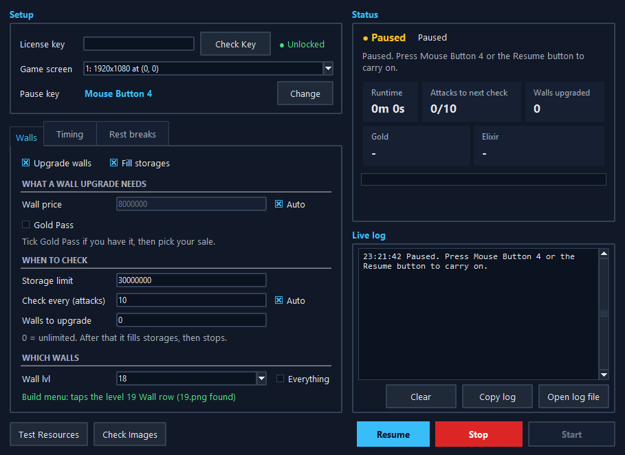
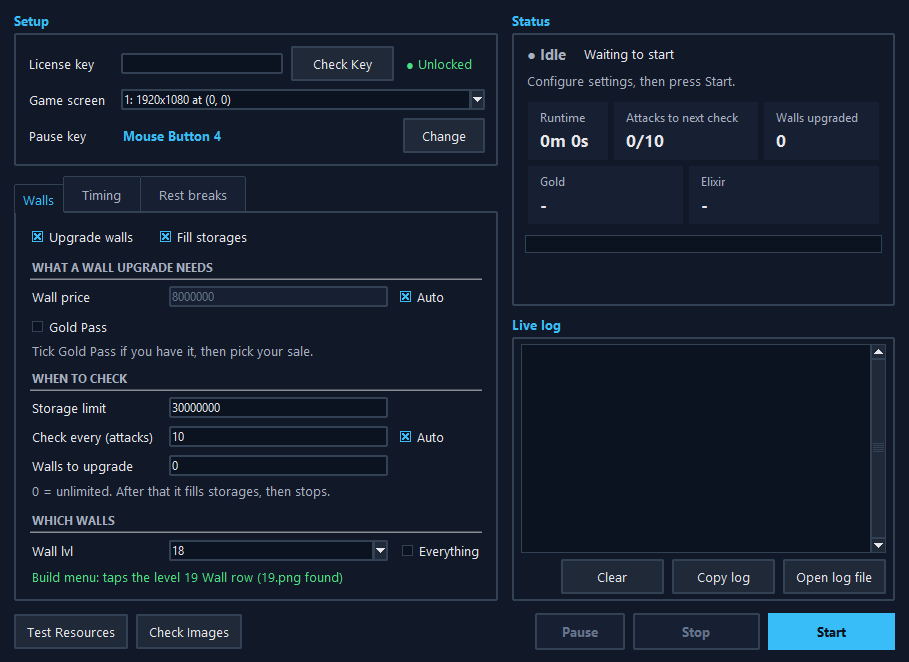
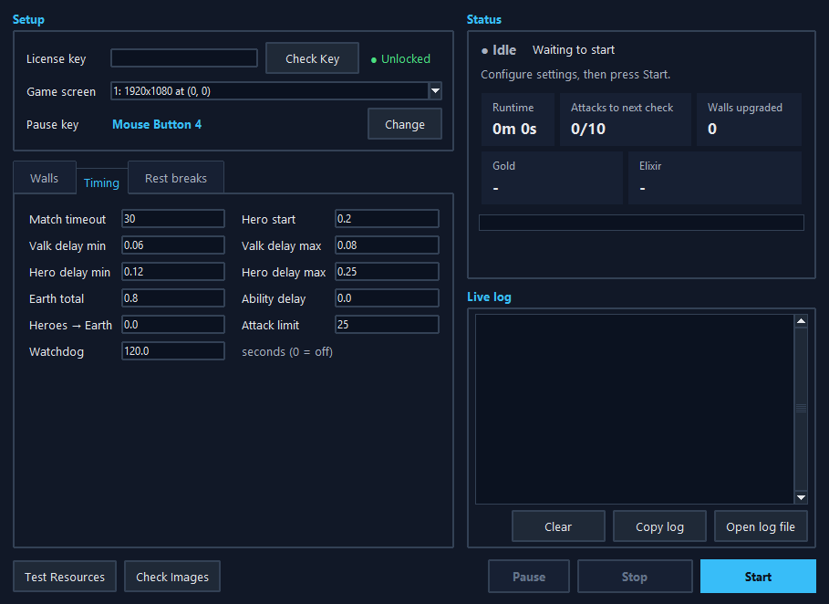
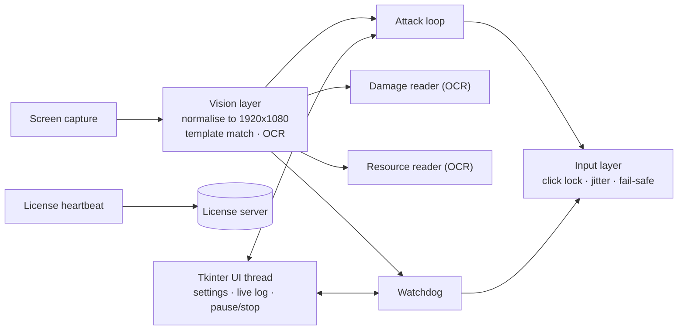
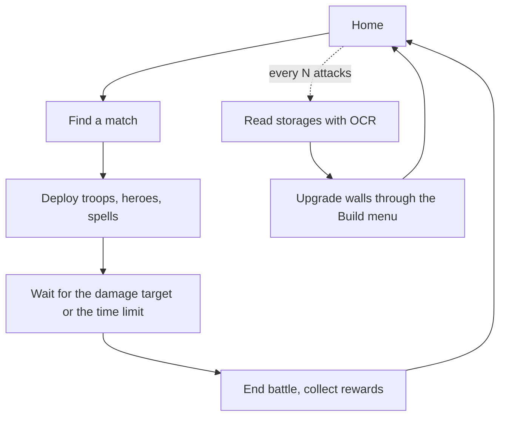

# COC Vision Bot

**A Windows desktop bot that plays a mobile strategy game by *looking at the screen*: computer vision to find buttons, OCR to read numbers, a watchdog that recovers when things go wrong, and a polished control panel on top.**

`Python` · `OpenCV` · `Tesseract OCR` · `Tkinter` · `multithreading` · `Win32 (ctypes)` · `unittest`

> **About this repository.** The bot is commercial, licensed software, so **its source code, image templates and licensing backend are not published here**. This repo is a technical showcase: what the system does, how it is built, the problems I hit while running it for hours unattended, and how I solved them. Everything below describes the real, working application.

<p align="center">
  
</p>

## At a glance

| | |
|---|---|
| Code | about **5,400 lines** of Python in the app, plus about **5,100 lines of tests** |
| Tests | **457 automated tests**, all passing (`unittest` + `mock`) |
| Concurrency | **5 cooperating worker threads**, plus listeners for global mouse and keyboard hotkeys |
| Vision | template matching on a screen normalised to 1920×1080, two separate OCR pipelines, scale-tolerant pop-up detection |
| Recovery | a **watchdog** that recognises 16 game screens and pop-ups from pictures and backs out of each one |
| Shipping | packaged as a standalone Windows `.exe`, with server-checked licensing and encrypted local secrets |
| Endurance | run unattended for **15+ hours in a single session** during development |

## What it does

The game has no public API, so the bot works the way a person does: it looks at the screen and clicks.

1. **Attack loop.** Finds a match, deploys troops, heroes and spells with human-like timing, uses hero abilities, watches the damage counter, and ends the battle once the target is reached or a time limit passes. Then it collects the rewards and returns home.
2. **Resource management.** Every few attacks it opens the shop, **reads the Gold and Elixir amounts with OCR**, and decides whether an upgrade is affordable. It learns how much each attack earns, so it checks sooner when a resource should have reached the price.
3. **Automatic upgrades.** Drives the in-game Build menu (filter, scroll, pick the right row, confirm) to upgrade walls with whatever resource is available, and can keep attacking until both storages are full.
4. **Self-recovery.** If nothing finishes for a set time, the watchdog works out which screen it is stuck on and gets back to the home screen (see [the case study below](#case-study-the-dialog-that-stopped-an-overnight-run)).
5. **Control panel.** Dark-themed Tkinter window with a live log, validated settings, a **rebindable pause key** and a Pause/Resume button.

<p align="center">
  
  
</p>

## How it works





More detail: [Architecture](docs/architecture.md) · [Vision and OCR](docs/vision-and-ocr.md) · [Reliability and testing](docs/reliability-and-testing.md)

## Engineering highlights

- **Resolution-independent vision.** Every screenshot is rescaled into one 1920×1080 "game pixel" space, so detection, OCR regions and click targets work on other monitor sizes and on multi-monitor setups.
- **OCR you can trust.** Two tuned pipelines (colour-masked damage counter, thresholded shop numbers), plus *plausibility checks on top*: impossible values are discarded, blank reads are retried, readings above the storage size are capped, and a measured income outside believable limits is ignored.
- **Never guess between look-alikes.** When picking a row from a list by picture, the match must be strong *and* no other candidate may score nearly as well; otherwise the bot refuses to click.
- **Concurrency without chaos.** Five workers share state through events and a click lock, so only one thread moves the mouse at a time. A new run cannot start until every thread of the previous run has really ended.
- **Instant, global controls.** A low-level Win32 mouse hook and a keyboard hook (through `ctypes`) give a pause key that works while the game has focus, and swallow the click so other programs never see it.
- **A UI that never freezes.** Network and long checks run off the UI thread; settings are validated as a whole and applied together, so one typo can never leave half the settings changed.
- **Secrets handled properly.** The license key is encrypted at rest with Windows DPAPI, and server replies are digitally signed and verified by the client.

## Case study: the dialog that stopped an overnight run

**Problem.** In a long unattended run the game showed a *"Connection lost"* dialog on top of the results screen. Nothing underneath was clickable, and the watchdog only recognised the screen *behind* the dialog. Its usual exit did nothing, the same stall repeated, and it **stopped the bot for good**.

**How I found it.** I read the run's log and the watchdog's own evidence screenshots: several near-identical "stuck" shots with the same dialog in the middle.

**Fix.** A pop-up detector that finds the dialog **at any size** (the dialog scales with the device, so it is matched across 0.5× to 1.6× and the click point follows the match), puts it first in the watchdog's priority list, presses *TRY AGAIN*, and never counts a lost connection as the bot being stuck.

**Result.** It then happened for real in a later run, and the log shows the recovery (about 23 seconds from the watchdog stepping in to being back on the home screen):

```text
Watchdog: no progress for 41s. Checking which screen the bot is on...
Watchdog: the bot is on Connection lost popup (connection_lost.png 0.91).
Watchdog: step 1/6: on Connection lost popup (connection_lost.png 0.91)
Watchdog: the game lost its connection. Pressing TRY AGAIN (picture match 0.91).
Watchdog: step 2/6: on an unknown screen (closest: close_panel.png 0.57, end2.png 0.54, option3.png 0.42)
Watchdog: back on the home screen. Bot resuming.
```

## Tested like a product

- **457 unit tests** cover the pure logic, the multi-threaded flows (start, stop, pause, license checks) and the UI state, with fakes standing in for the screen and the mouse.
- **Real screenshots as fixtures.** Detection is tested against captured 1080p frames, then against synthetic variants: the same dialog pasted at 0.6×, 0.9×, 1.3× and 1.6×, blank frames, tiny frames, and screens that must *not* match.
- **Bugs found in real runs are turned into regression tests**, so the same failure cannot come back unnoticed.

## Tech stack

| Area | Tools |
|---|---|
| Language | Python 3 |
| Vision | OpenCV (`matchTemplate`, colour masks, connected components), NumPy |
| OCR | Tesseract via `pytesseract`, custom pre-processing |
| Screen and input | `mss` for capture, `pyautogui` for input, Win32 hooks through `ctypes` |
| UI | Tkinter / ttk with a custom dark theme, tooltips and a live log |
| Security | Ed25519 signature checks (`cryptography`), Windows DPAPI for secrets at rest |
| Quality | `unittest`, `unittest.mock`, real-screenshot fixtures |
| Packaging | Nuitka, standalone Windows executable |
| Backend | small serverless licensing service (Cloudflare Workers) |

## Honest limitations, and what I would do next

- Windows only, and tuned for 16:9 screens. It matches the game's *pictures*, so a big art update means refreshing templates.
- OCR is mitigated by sanity checks but not perfect; bad reads still happen occasionally and are handled by retrying or ignoring them.
- The application is a single large module. Splitting it into a package (vision, input, workers, UI) is the next structural improvement.
- Ideas not built yet: one log file per session instead of overwriting at launch, and a watchdog recovery step for one more game screen.

## Skills this project demonstrates

Computer vision · OCR · concurrent programming · state machines and failure recovery · desktop UI design · low-level Windows APIs · test design · debugging from logs · security basics (signed responses, encrypted secrets) · shipping a packaged application.

---

*Not affiliated with, endorsed by, or connected to Supercell. Clash of Clans is a trademark of Supercell Oy. No game assets are included in this repository.*

Built by Ali ([@Ali-Siaj](https://github.com/Ali-Siaj)). The source code is private.
