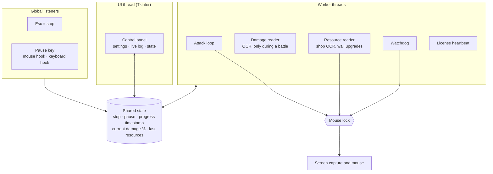

# Architecture

*This page describes how the application is put together. The source code itself is private.*

## The big picture

The bot is one desktop application made of a UI thread and five long-running worker threads. The workers never talk to each other directly. They share a small amount of state (a few flags, counters and the latest readings) and coordinate through events and a single "mouse lock".

## The five workers

| Worker | Job | Notes |
|---|---|---|
| **Attack loop** | The main game loop: find a match, deploy, wait for the damage target, end the battle, collect rewards, go home | Every wait inside it is *interruptible*: it honours stop, pause and "target reached" |
| **Damage reader** | Reads the damage percentage on screen | Sleeps until a battle starts, so Tesseract is not launched when there is nothing to read |
| **Resource reader** | Every N attacks, checks the storages and runs wall upgrades | Holds the mouse lock for the whole check so the attack loop cannot click over it |
| **Watchdog** | Notices when nothing has finished for too long, identifies the screen, recovers | Takes the mouse lock with a timeout, so a wedged check cannot wedge the watchdog too |
| **License heartbeat** | Periodically re-validates the license with the server | Runs off the UI thread; network trouble never freezes the window |

## Rules the design follows

1. **Stopping is a flag, and everything checks it.** There is no killing of threads. Every loop and every wait looks at a stop event, so a stop lands within a fraction of a second even in the middle of a long wait.
2. **A new run never overlaps an old one.** Pressing Start first waits for the previous run's threads to be really gone. Otherwise an old thread could wake up after the stop flag is cleared and carry on beside the new one.
3. **One thread moves the mouse at a time.** All clicking goes through a lock. The watchdog and the resource check can therefore never fight over the cursor.
4. **Pause is cooperative.** Pause is another event. Long operations check it between steps, so pausing never leaves a drag half done. The watchdog treats a pause as "not stuck".
5. **Waiting on purpose is not being stuck.** Rest breaks and similar deliberate waits tell the watchdog to hold, so it does not fire during them.
6. **The UI thread only draws.** Workers hand updates to it through a queue and `after()` callbacks. Anything slow (license check, shop test) runs on a helper thread and reports back.

## Input layer

- **Human-like input.** Click positions get a small random offset, delays between drops are random within a configured range, and optional rest breaks can be scheduled every N attacks.
- **Fail-safe.** Throwing the mouse into a screen corner (PyAutoGUI's fail-safe) stops the bot safely. **Esc** also stops it.
- **Pause key.** A low-level Windows mouse hook and a keyboard hook run on their own listener threads. While the bot runs, the pause key is *consumed* so it does not leak into the game or the browser. The key is rebindable: press *Change*, then any keyboard key, Mouse Button 4/5 or the middle button. Esc and the modifier keys are refused as pause keys.

## Settings

- Settings are saved as JSON and restored at launch.
- **Validate everything first, then apply everything.** If any field is invalid (a typo in one number), nothing at all is changed, so settings can never end up half-applied.
- Invalid numbers are outlined in red as you type, using the very same parser Start uses, so the outline can never disagree with Start.
- Features can be switched on or off remotely (for example wall upgrades), and the server can require a minimum app version.

## Licensing and security (overview)

- Each license is checked with a small serverless backend (Cloudflare Workers) when the bot starts and on a heartbeat while it runs.
- The server's replies are **digitally signed (Ed25519)** and verified by the client, so a tampered reply fails verification.
- The license key is **encrypted at rest with Windows DPAPI**, tied to the Windows account, and is never written to disk as readable text.

## Packaging

The application is built into a single standalone Windows executable with Nuitka. Template pictures are bundled into it. Wall-row pictures and watchdog screenshots live in editable folders beside the executable.
