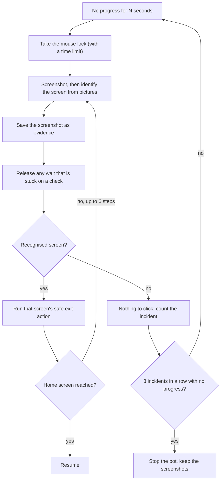

# Reliability and testing

*How the bot keeps going for hours, and how I know it still works after every change.*

## The watchdog

A game bot fails in ways you cannot predict: a pop-up nobody planned for, a slow network, a screen that looks slightly different. Instead of trying to predict everything, the bot has a watchdog that notices *the symptom*: no real progress for a configurable time.

Design choices:

- **It recognises 16 screens and pop-ups from pictures**, checked in a priority order: pop-ups first, because a pop-up covers the screen underneath it.
- **Recovery is safe by construction.** Every exit action is an image-matched click or a re-run of the normal end-of-battle sequence. The watchdog never deploys anything.
- **Deliberate waits are not stuck.** Pausing and rest breaks hold the watchdog.
- **Evidence is kept.** Each incident saves the screenshot it saw (the newest 20 are kept), so a failure can be diagnosed after the fact instead of guessed at.
- **It gives up politely.** After three consecutive incidents with no progress, the bot stops and says where the screenshots are, rather than clicking forever.
- **Known exceptions.** A lost connection is not the bot being stuck, so it never counts toward that limit (see the case study in the [README](../README.md#case-study-the-dialog-that-stopped-an-overnight-run)).

## Testing strategy

The suite has **457 tests**, grouped into many focused test classes, written with the standard library's `unittest` and `mock`. It runs in about a minute and a quarter.

| Kind of test | What it protects |
|---|---|
| Pure logic | Parsing, validation, price calculations, the Gold Pass discount, wall-level choices |
| Vision against real frames | Detection scores on captured 1080p screenshots, plus must-not-match checks on other screens |
| Synthetic variants | The same picture at different scales, blank frames, tiny frames, missing template files |
| Threaded flows | Start, stop, pause and license-check sequences, with fakes for threads so the order of events can be asserted |
| UI state | The Pause/Resume button, the pause-key capture flow, the state indicator, settings apply/save |
| Watchdog | Priority order of screens, exit actions, the incident counter, the "never stop for a lost connection" rule |
| Source guards | A few tests read the source to make sure a rule is not accidentally undone (for example that the attack loop uses the per-attack time limit) |

### Habits that made the suite useful

- **A bug found in a real run gets a regression test.** The Connection-lost pop-up and the storage-reading guards both came from real runs and are covered by tests.
- **Tests never touch real files.** The log and the screenshot folder are redirected to a temporary directory for every run, so running the tests can never disturb a live session.
- **Tests state the behaviour in plain words.** Names read like sentences ("the hook takes the press and the release while the bot runs"), so a failure explains itself.
- **Fakes, not the real screen.** The default "monitor" in tests is a blank 1920×1080 image, so results never depend on the PC the tests run on.

## Debugging from logs

Every action is written to a session log and mirrored in the live log pane, colour-coded (errors, watchdog events, good news). That log is how most real problems were found: reading a long run's log shows the *pattern* (the same picture missing every attack, a number that is always read with one digit too many) that a single failure never would.
